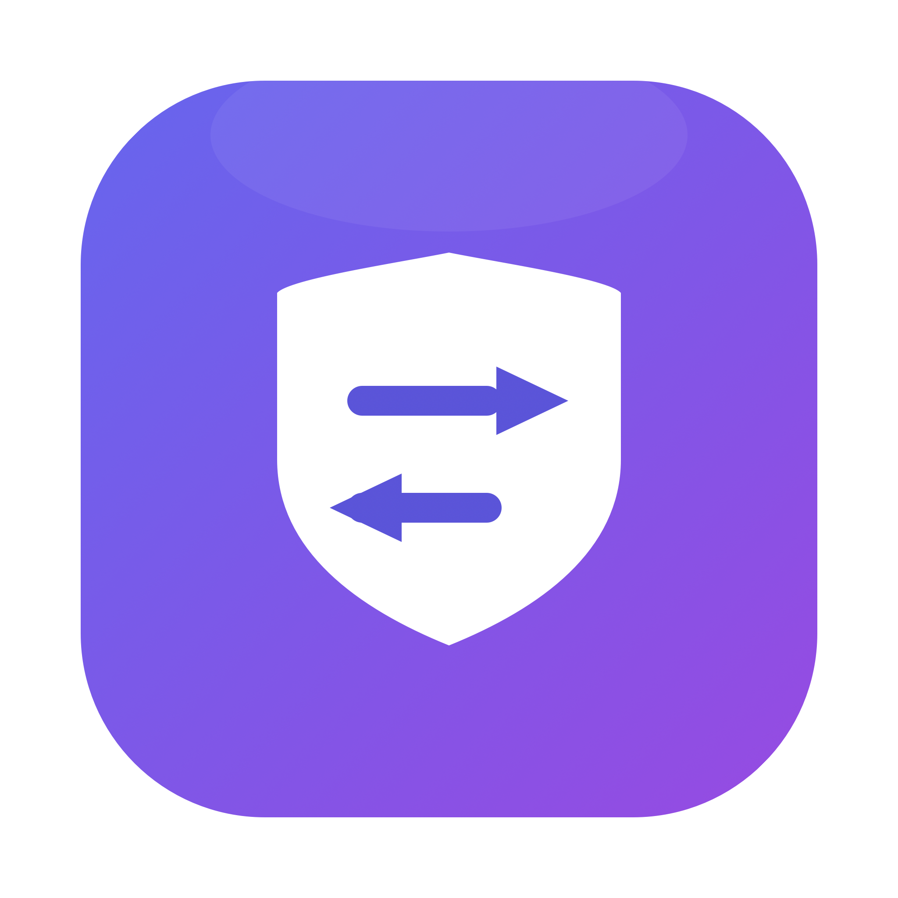

<div align="center">

# ClaudeSwitcher

**A fail-closed local environment manager for multiple Claude accounts**

[中文](README.md) · [Releases](https://github.com/parafallen-maker/claude-network-rules/releases/latest) · [Issues](https://github.com/parafallen-maker/claude-network-rules/issues)



</div>

---

This is the **1.9.0** customized branch of [YOURSJEYO/claude-switcher](https://github.com/YOURSJEYO/claude-switcher), distributed from [parafallen-maker/claude-network-rules](https://github.com/parafallen-maker/claude-network-rules). The upstream attribution and MIT license are retained. Historical behavior and examples are not evidence of live validation for this branch.

## What it is

ClaudeSwitcher keeps several Claude accounts on one Mac without letting their
local state mix. Each account has a separate local snapshot of sign-in state and application data.
Switching uses a journaled directory transaction instead of signing out and back
in. This does not guarantee how the server identifies an account or device.

Before Claude starts, the app runs a 14-point audit of the machine's network and
regional environment. If a blocking check fails, the app is not launched. A
resident bodyguard stops the protected application when the tunnel drops,
reducing, but not eliminating, the interval in which traffic could leave outside the proxy.

## Features

- **14-point preflight audit** — proxy core, TUN interface, exit country, IP stability, time zone, locale, IPv6, DNS resolution signals, STUN results, bodyguard status, pinned routing, browser language, ASN type, and Claude reachability.
- **Snapshot switching** — archives and restores whole account directories; APFS copy-on-write cloning avoids duplicating unchanged data.
- **Process-level bodyguard** — the customized macOS monitor checks proxy/node state each second and probes exit IP every five seconds. It can stop the protected Claude desktop process; it does not manage Claude Code CLI. See [monitor behavior](docs/network/MONITOR.md) for deadlines and limits.
- **Drift watchdog** — records a baseline for time zone and proxy settings and rolls back silent changes made by other software.
- **Multiple proxy clients** — detects Clash Verge, FlClash, Shadowrocket, sing-box, ClashX, and Surge, with an automatic mode. Clash Verge and FlClash repairs install and verify routing rules with rollback; other non-Clash clients keep their own configuration.
- **Region adaptation** — captures the exit country, time zone, and locale at install time and re-locks all three after moving to a different node.
- **Pinned routing** — places Claude domains and supporting services above third-party rule sets.
- **WebRTC leak probe** — a standard-library STUN client that compares global and local vantage points to distinguish a proxied path from a direct one.
- **Automatic updates** — a user-level launchd agent checks every 12 hours, verifies artifact hashes, and rolls back if the post-update self-check fails.
- **Diagnostics** — a standalone proxy check reports transport results for the Claude web and API endpoints without reading account data.
- **Native menu bar UI** — a single-file SwiftUI app, now including Network, System and AdsPower configuration pages. Full macOS ZIP/DMG packages include the installer resources needed for first use.
- **Web check page** — a static browser-side check for exit IP, time zone, language, WebRTC, IPv6, and common fingerprint signals.
- **Windows and Linux ports (beta)** — PowerShell and bash implementations with the same audit and switching model. Windows also includes A–D accounts, proxy-client switching, read-only inspection tools, isolated browsing, standalone proxy diagnostics, and encrypted `.csnap` snapshots (not compatible with macOS DMG). New Windows UI and runtime flows still require hardware verification; static checks are not a substitute.

## Version 1.9.0

This customized release adds macOS environment configuration, reversible setup for a selected AdsPower profile, and full App ZIP/DMG packages with an embedded installer. The installed proxy-group name stays fixed across the user scripts and system service. A missing group can be created across subscriptions; a new group initially selects REJECT until the user chooses a node.

The earlier journaled account recovery, shared mutation locks and component rollback remain in place; see the historical [1.8 reliability notes](docs/RELIABILITY-1.8.md). The new configuration UI is macOS-only. See [environment configuration and recovery](docs/network/ENVIRONMENT.md), [AdsPower behavior](docs/network/ADSPOWER.md), and [network boundaries](docs/network/README.md). Build tests and simulated API tests do not replace live proxy, system or browser validation.

## Install

### Download (recommended)

Use this repository's [latest release](https://github.com/parafallen-maker/claude-network-rules/releases/latest) and select an architecture actually provided in its attachments:

| Asset | Use |
| --- | --- |
| `ClaudeSwitcher-1.9.0-macos-<arch>.dmg` / `.zip` | Complete precompiled macOS App with core components, the system-service installer and notification helper; suitable for first installation and updates. |
| `ClaudeSwitcher-1.9.0-installer-kit.zip` | Complete source installer resources; requires Swift and the Apple SDK to build locally. |
| `ClaudeSwitcher-1.9.0-source.zip` | Source archive for development and review. |

Copy `Claude切换器.app` to Applications and open it. On first use, or when the bundled and installed component versions differ, click **安装本机组件** (Install local components). Complete the Terminal installer and administrator verification, then click **完成安装后重新检查** (Recheck after installation). The installer verifies the embedded source and precompiled App and commits only after its checks; failure preserves or restores the previous installation.

Unlike older `app-only` packages, these ZIP/DMG files contain the full installation resources. Installing system services still requires administrator authorization. Precompiled App installation requires Python 3 and does not recompile Swift. Account directories, proxy credentials and browser data are not included in the distributed App.

Default builds are ad-hoc signed and **not notarized**. If Gatekeeper blocks first launch, open the app from its context menu or allow it under System Settings → Privacy & Security. Verify downloads against the checksum file included with the release; a valid checksum or local signature is not notarization.

Requirements: macOS 13 or later, Python 3, the Claude desktop app and a proxy with verifiable TUN routing. Existing Windows/Linux implementations remain Beta; this release's new macOS configuration features and validation claims do not apply to them.

### From source

```bash
git clone https://github.com/parafallen-maker/claude-network-rules.git
cd claude-network-rules/claude-switcher
# Then double-click installer/安装.command
```

Source and installer-kit installation require Python 3, Swift and the Apple SDK. To build manually:

```bash
CLAUDE_SWITCHER_BUILD_ARCH=universal bash scripts/package-macos.sh "$(cat VERSION)"
```

Artifacts are written to `build/`. A source archive or installer kit contains no precompiled App. Default updates follow releases pinned to a commit; GUI/root component changes stage a full installer and preserve the active set until installation. System settings require `--configure-system`; managed proxy edits require `--configure-proxy`. See [build/update instructions](docs/INSTALL-UPDATE-TRANSACTIONS.md).

## Usage

1. Open **Claude切换器** and wait for the 14 checks.
2. When all blocking checks pass, choose an account and launch Claude. Explicitly skipped optional checks remain marked as skipped; they are not passes. If a blocking check fails, use repair and recheck.
3. Sign in once for each additional account; later switches keep sessions
   independent.
4. After changing to a node in another country, use the System configuration page or run `~/.local/bin/claude-switch.sh set-region`.
5. Open **环境配置** (Environment configuration) from the main window, check settings or menu bar. Preview network changes before applying; Apply/Restore can briefly restart Clash Verge. The installed group name is read-only, and new groups require a manual node selection.
6. For AdsPower, enable its Local API and choose a closed profile. The app only manages proxy settings and recoverable WebRTC fields; it never opens the profile. If WebRTC cannot be read back, it reports the remaining manual step instead of claiming completion.

The full command set, menu bar behavior, and troubleshooting notes are in the
[Chinese README](README.md) and [AGENTS.md](AGENTS.md).

## Disclaimer

This project is intended for managing the local environment and sign-in state of
multiple Claude accounts in supported regions, for people who are traveling,
living abroad, or otherwise legitimately located in a supported region. Please
follow Anthropic's Terms of Service. Do not use it for account resale, account
sharing, registering accounts on behalf of others, or circumventing regional
restrictions.

Local environment checks only inspect and configure this machine. They do not
change server-side records and do not guarantee that an account will not be
restricted. The software is provided as-is under the MIT license; you are
responsible for how you use it.

## Links

- [中文说明](README.md)
- [Releases](https://github.com/parafallen-maker/claude-network-rules/releases)
- [Issues](https://github.com/parafallen-maker/claude-network-rules/issues)
- [Security policy](SECURITY.md)
- [Agent handoff guide](AGENTS.md)
- [Environment configuration](docs/network/ENVIRONMENT.md) · [AdsPower setup](docs/network/ADSPOWER.md)
- [Upstream Web environment check](https://yoursjeyo.github.io/claude-switcher/) (maintained separately)
- [Upstream source and history](https://github.com/YOURSJEYO/claude-switcher)
- [Windows beta](windows/README.md) · [Linux beta](linux/README.md)

## License

MIT © ClaudeSwitcher Contributors
