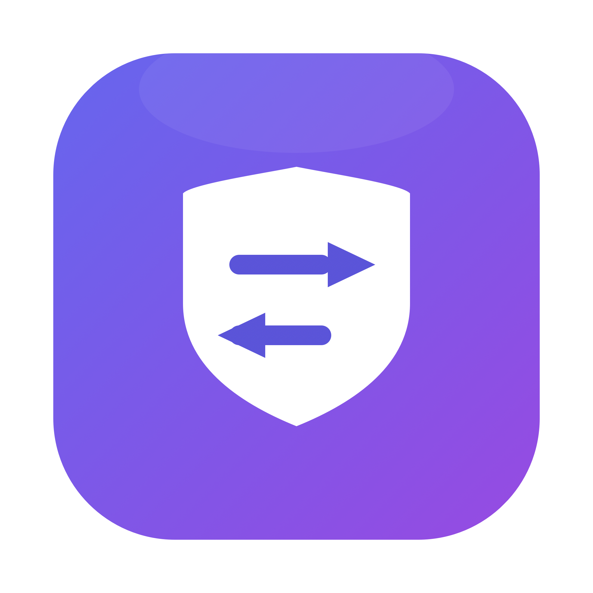

<div align="center">

# Claude 切换器

[English](README.en.md) · [Releases](https://github.com/parafallen-maker/claude-network-rules/releases/latest)

**macOS 账号环境管理器：先检查网络与地区，再切换账号**

> 本目录是 [YOURSJEYO/claude-switcher](https://github.com/YOURSJEYO/claude-switcher) 的定制分支，保留 MIT 许可与上游归属。当前版本为 **1.9.0**；下载与问题反馈使用本仓库，历史记录不代表本版新增功能已完成真机验收。

[](LICENSE)
[](https://github.com/parafallen-maker/claude-network-rules/releases/latest)
[]()
[](windows/)
[](linux/)
[]()
[]()



</div>

---

## 用途声明

本项目用于在合规地区管理多个 Claude 账号的本地环境与登录态，面向因出差、旅居等原因身处支持地区的用户。请遵守 Anthropic 服务条款；禁止用于账号转售、共享、代注册或规避地区限制。本地环境检查只影响本机配置，不改变服务端记录，也不构成账号不被限制的保证。

## 为什么做这个

AI 服务平台的风控已经从"看 IP"进化到**全维度环境画像**：时区、Locale、DNS 出口、WebRTC 候选地址、设备指纹、行为时序。本工具检查可观察的本地网络与地区状态，减少配置不一致；无法仅凭本机检查判断账号限制的原因。

本项目的立场：**防御不建立在"用户记得"上，而建立在系统级的硬性约束上**。

> 代理暴毙、软件静默升级、随手乱点——这些场景下受保护进程会被保镖在秒级终止，裸连窗口被压缩到最小。这是**进程级急停**，不是防火墙级保证：巡检周期内存在固有的 TOCTOU 窗口，边界说明见 [SECURITY.md](SECURITY.md)。

## 核心创新

### 1. Block-on-Fail 环境审计引擎

每次启动前执行 14 项环境指纹审计。**硬性安全项失败时，应用不会被拉起**；只有显式配置的非关键项可以跳过或降级为警告，跳过不代表检查通过。

| # | 检查项 | 防什么 |
|---|---|---|
| 01 | 代理内核 | 代理根本没在跑就启动 |
| 02 | TUN 网卡 | 系统代理开着但流量没被接管 |
| 03 | 出口 IP | 出口国家/地区异常 |
| 04 | IP 一致性 | 出口 IP 突变（跳节点是风控信号） |
| 05 | 时区 | 系统时区与 IP Geo-location 冲突 |
| 06 | 地区 Locale | 系统区域设置不符 |
| 07 | IPv6 | 双栈旁路直连（最隐蔽的泄漏通道之一） |
| 08 | DNS 解析 | 报告解析行为；fake-IP 不能证明 DNS 上游或排除泄漏 |
| 09 | WebRTC | 多节点 STUN 交叉探测（详见第 2 节） |
| 10 | 保镖守护进程 | Kill-Switch 是否在线（详见第 3 节） |
| 11 | 置顶路由规则 | 生态域名是否被强制走代理（详见第 6 节） |
| 12 | 客户端语言 | 防止 JS 层 `navigator.language` / `Intl` 读出系统中文 |
| 13 | ASN 属性 | 住宅宽带 vs 机房 IP（Residential vs Datacenter） |
| 14 | 生态可达性 | claude.ai / api.anthropic.com 连通性验证 |

> 关于「IP 与上次一致」：除了比对上一次出口，审计引擎还会维护 48 小时出口 IP 历史——**48 小时内出口 IP 变化 ≥3 次会亮黄色警告**（不阻断启动）。IP 频繁漂移意味着账号画像在风控眼里"居无定所"，建议固定一条高质量住宅节点长期使用。禁用 IP 一致检查后不会执行出口比对，也不会写入这份历史。

### 2. 纯标准库手写 STUN 协议栈的 WebRTC 泄漏探针

不依赖浏览器内核（headless Chrome 的 ICE 子系统在无人值守场景下根本不工作——我们踩过这个坑），直接用 `socket` + `struct` 手工构造 RFC 5389 Binding Request，解析 XOR-MAPPED-ADDRESS。

探测列表包含多个 STUN 服务。响应必须匹配请求的事务号、协议头、报文边界和来源，并分别评估 IPv4/IPv6。返回地址与预期出口不一致会失败；无响应只能表示未知，只有已验证的拒绝规则才能支持“按规则拒绝”的结论。STUN 结果不能替代浏览器 ICE 或整机抓包验收。

### 3. 进程级保镖与可选网络层保护

常驻保镖巡检代理进程、活动接口、实际路由和可读取的运行规则；异常时终止受保护进程。检查间隔仍有时间窗口。macOS 新增默认关闭、需显式启用的实验性 PF 模块，严格限定父规则、状态表和代理端点；它不是自动兼容任意现有防火墙的开关，详见 [网络保护说明](docs/network/README.md)。

### 4. Session Snapshot 快照隔离

每个槽位保存独立本地快照。切换先退出应用，在持有跨进程锁时准备数据、写事务日志、提交目录和账号标记；崩溃后按日志恢复，不把不同账号的数据混归档。它隔离本地状态，不承诺服务器看到恒定设备，也不能消除服务端记录。

复制优先使用 macOS APFS clone 或 Linux reflink，失败后回退完整复制。事务提交还需要数据同步和目录换位，不能承诺零耗时。旧版不明归属的恢复目录会保留并提示人工核对，详见 [账号恢复说明](docs/ACCOUNT-RECOVERY.md)。

### 5. 配置漂移自愈（Watchdog）

软件更新会静默重置你的安全配置（我们的生产环境里，TUN 开关被代理客户端更新重置了 4 次，系统时区被改回 8 次）。Watchdog 周期巡检 + 基线回滚 + 全程留痕，配置漂移从"事故"降级为"日志里的一行记录"。

### 6. 托管分流

本定制版使用固定顺序的 51 条规则：常见 STUN 端口按所选策略处理，Claude 与 IP 检测优先走专用代理组，国内与局域网直连，其余流量代理。运行时核对实际规则；未列出的站外检测端点仍可能按国内规则直连。详见[网络配置说明](docs/network/ENVIRONMENT.md)。

## 上游历史记录

以下为保留的上游历史示例，不作为 1.9.0 新增环境配置或 AdsPower 联调的验收证据：

```
2026-10-07 00:31:12  代理离线(内核或TUN丢失),已自动关闭 Claude   ← Kill-Switch 真实拦截
2026-10-04 12:55:26  时区异常: [Asia/Shanghai] 已自动恢复        ← Watchdog 第 8 次拦截漂移
```

## 界面

原生 SwiftUI 界面提供环境检查、账号切换、菜单栏与「环境配置」入口。后者分为网络、系统和指纹浏览器三页；配置期间显示操作状态，并区分已完成、部分完成和仍需手动处理。

## 1.9.0 定制版

本版新增 macOS 环境配置、AdsPower 单环境代理配置，以及包含完整安装资源的 App ZIP/DMG。网络配置沿用安装时的代理组；跨订阅缺组时可自动补建同名组，新组首次选择 REJECT，需用户选择节点后验证。具体范围、恢复和实际验收边界见[环境配置](docs/network/ENVIRONMENT.md)与 [AdsPower 配置](docs/network/ADSPOWER.md)。

此前 1.8 系列的账号事务恢复、共享锁、整套组件更新回滚与安装事务继续保留，历史设计见[可靠性说明](docs/RELIABILITY-1.8.md)。本版号属于当前定制仓库，不代表上游同名版本；Windows/Linux 仍为 Beta，未同步新增 macOS 配置界面。

## 安装

**系统要求**：macOS 13+、Python 3、Claude 桌面版、可验证活动 TUN/路由的代理。源码安装另需 Apple SDK 与 Swift 编译器。Clash Verge / FlClash 已提供运行规则适配；其他客户端在运行策略无法验证时会阻止受保护启动，不能仅凭客户端名称或 fake-IP 放行。

> **Windows 用户**：[`windows/`](windows/) 目录提供 Windows 版（PowerShell + WPF，Beta），安装与注意事项见 [windows/README.md](windows/README.md)。
> **Linux 用户**：[`linux/`](linux/) 目录提供 Linux 版（bash + systemd，Beta），设计取舍（无官方桌面版→切换浏览器登录态）见 [linux/README.md](linux/README.md)。

### 直接下载（推荐）

从本仓库 [Releases](https://github.com/parafallen-maker/claude-network-rules/releases/latest) 选择适合本机架构的附件；实际可用架构以该 Release 为准：

| 文件 | 用途 |
| --- | --- |
| `ClaudeSwitcher-1.9.0-macos-<架构>.dmg` / `.zip` | 完整预编译 App，内置核心组件、系统服务安装器与通知助手，支持首次安装和更新 |
| `ClaudeSwitcher-1.9.0-installer-kit.zip` | 完整源码安装资源；在本机编译，需要 Swift 与 Apple SDK |
| `ClaudeSwitcher-1.9.0-source.zip` | 源码归档，供开发与审查 |

ZIP 解压或打开 DMG 后，将 `Claude切换器.app` 放入「应用程序」并打开。首次使用或组件版本不一致时，点击 **「安装本机组件」**，完成终端中的管理员验证，再点击「完成安装后重新检查」。安装器校验内置资源和预编译 App，完成检查后才提交；失败保留或恢复旧安装。预编译 App 安装需要 Python 3，不需要重新编译 Swift。

1.9.0 ZIP/DMG 已包含完整安装资源，区别于早期 `app-only` 界面包；系统服务仍需通过安装器获得管理员授权。账号目录、代理凭据和浏览器资料不随 App 分发。

默认构建使用 ad-hoc 签名、未经 Apple 公证。首次打开若被 Gatekeeper 拦截，可右键打开，或在「系统设置 → 隐私与安全性」中允许打开。校验签名和 SHA256 不等同公证；下载后使用 Release 附带的校验文件核对工件。

Windows/Linux 的既有 Beta 实现保留在各自目录，本次 macOS 新功能和验收结论不适用于这些平台。

### 从源码安装

```bash
git clone https://github.com/parafallen-maker/claude-network-rules.git
cd claude-network-rules/claude-switcher
# 双击 installer/安装.command，或在终端打开它
```

源码与 installer-kit 安装需要 Python 3、Apple SDK 与 Swift 编译器。安装程序识别代理客户端、组名及地区目标；系统设置与代理配置按安装选项执行。更多构建、恢复和更新说明见[安装更新事务](docs/INSTALL-UPDATE-TRANSACTIONS.md)。

## 地区自适应

不再锁死美国：安装程序按当前出口国家选择**目标国家 + 时区 + 地区格式**；实际修改系统设置需显式 `--configure-system`，写入代理托管规则需 `--configure-proxy`，原值会用于卸载恢复。地区目标采用该三件套（出口是 CN 会直接拒装，逼你先挂好代理）。地区识别按 ipinfo → ipapi → ifconfig → Cloudflare trace 多源依次探测，单个域名被规则判直连、被墙或限流时会自动换下一个源；全部失败时交互式安装器会列出诊断并让你手动选地区（`FORCE=1` 则强制 US / America/New_York）。之后换了其他国家的节点，不用重装，一条命令重新适配：

```bash
~/.local/bin/claude-switch.sh set-region
# 自动探测出口国家 → 改写自身配置 → 设地区格式 → 弹一次授权锁时区 → 同步看门狗
# 输出: OK:region=JP tz=Asia/Tokyo locale=ja_JP source=ipinfo
```

14 项检查里的「出口 IP / 时区 / 地区」全部按新目标判定，界面无需任何改动。

## 不会配置？交给你的 AI

仓库根目录的 [`AGENTS.md`](AGENTS.md) 是一份完整的 **Agent 交接提示词**：把它直接粘贴给你的本地模型（Kimi Code / Cursor / Claude Code 等），它会按文档自动完成环境检查、安装、配置与验收。里面还附了我们实战踩过的全部坑的排障手册。

## 使用

1. 双击桌面「Claude切换器」→ 等待 14 项检查
2. 硬性安全项全部通过 → 选账号启动；有红项 → 「一键修复」自动处理。灰色跳过项仅代表用户明确关闭了对应非关键检查
3. B/C/D 账号首次使用登录一次，以后 A–D 随切随用、互不干扰
4. 换了其他国家的节点 → 跑一次 `~/.local/bin/claude-switch.sh set-region`，国家/时区/地区格式一键重新锁定
5. 换了代理客户端 → 在界面「代理客户端」下拉菜单选中即可切换（或 `set-client` 命令），切换后自动重新审计

### 环境配置（macOS）

主窗口的「环境配置」、齿轮设置页与菜单栏均可打开三页配置：

- **网络**：预览并应用 Clash Verge 分流、DNS 与浏览器专用入口；已安装代理组只读，缺组可补建，新组先 REJECT。应用或恢复会短暂重启代理，保留恢复记录。
- **系统**：按当前实际出口更新地区目标，或应用当前目标并修复环境，完成后重新检查。
- **指纹浏览器**：通过本机 AdsPower Local API 配置一个已关闭环境。API 未提供可恢复的 WebRTC 原设置时，只配置代理并提示手动完成；不自动启动浏览器。

本版只为 macOS 增加这些入口。Swift 编译、界面渲染与假核心/假 API 测试已覆盖关键交互；实际代理生效、系统管理员操作、AdsPower 权限与浏览器出口需分别验收。详见[配置与恢复说明](docs/network/ENVIRONMENT.md)和 [AdsPower 接口边界](docs/network/ADSPOWER.md)。

### 检查设置与诊断日志

点击主窗口右上角齿轮，或菜单栏盾牌里的「检查设置」，可分别关闭 `IP一致`、`DNS`、`WebRTC`、`客户端语言`、`ASN属性`、`生态可达性` 这 6 项非关键检查。关闭后不会执行对应探测，界面显示灰色 `skip`，**不表示检查通过**。「将上述非关键项的失败降为警告」只影响这 6 项；出口国家与目标一致性、代理/TUN、Kill-Switch、保镖、账号归档安全、root 权限边界和更新 SHA256 等硬性安全项不能关闭或降级。

设置保存在 `~/.claude-switcher/checks.json`。也可使用命令行：

```bash
~/.local/bin/claude-switch.sh get-check-config
~/.local/bin/claude-switch.sh set-check-config '{"disabled":["DNS"],"allowOptionalFailures":false,"logging":true}'
```

脱敏客户端日志默认开启，位于 `~/Library/Logs/claude-switcher/client.log`，达到 512 KiB 后轮转为 `client.log.1`。日志只记录命令、退出码、耗时和检查状态，不记录公网/住宅/代理 IP、Bearer/token/session/cookie、账号内容或 Clash 配置。点击设置里的「导出诊断日志」，或运行 `~/.local/bin/claude-switch.sh export-diagnostics <文件路径>`，可生成只含日志、检查设置和脱敏环境/状态摘要的 zip；不包含账号快照、`lastip`、`iphistory` 或原始 `last-check.txt`。

### macOS 菜单栏常驻

启动后，顶部菜单栏会显示盾牌图标，Dock 不显示应用图标。首次启动自动打开主窗口；关闭窗口或切换账号成功后只隐藏窗口，仍可从盾牌菜单重新打开。

- 菜单显示当前账号和「最近检查」结果（通过 / 通过（含跳过）/ 有警告 / 失败 / 检查中），提供「打开主窗口」「环境配置」「检查设置」「导出诊断日志」「重新检查」「退出 Claude 切换器」。A–D 切换仍在主窗口完成。
- 启动时检查一次；隐藏期间不轮询网络，展开菜单只读取本地账号状态。每次切换账号前会重新完成全部环境检查，检查失败、超时或输出不完整时不会执行切换；警告沿用现有放行规则。
- 检查、修复、切换和指纹体检期间不会重复执行操作；修复、账号切换或环境配置操作期间暂时不能退出。操作结束后可从菜单明确退出。
- 退出切换器不会卸载或停止独立的保镖、时区看门狗和自动更新服务。应用本身不会因此新增登录自启动。

从旧版升级时，请通过新版 App 内的「安装本机组件」同步完整组件。`update` 会验证整套组件；若 GUI 或 root 组件变化，会暂存完整安装包并保留当前安装，提示运行安装器。

开发者可运行 `python3 -m unittest discover -s tests -v`。自动化测试使用隔离目录和假网络服务；界面编译、模型测试与实际联调的边界见[环境配置验证范围](docs/network/ENVIRONMENT.md#验证范围)。

## 多账号（A–D）

除 A/B 外，还支持 C、D 两个账号槽位，最多同时保留四份互不干扰的登录态。

- **创建**：在账号卡片里点击「账号 C」或「账号 D」的空槽位即可。首次使用会在 Claude 里看到登录页，登录一次后该槽位自动成为该账号的独立身份。
- **卡片含义**：
  - `当前`：切换器正在使用的账号
  - `已建档 · 1.2G · 10-20`：该槽位已有独立快照，附带快照体积与最后归档日期
  - `未初始化`：空槽位，点击后创建新身份
- **快照位置**：`~/.claude-switcher/accounts/<A|B|C|D>/`。切换时当前账号会先归档到对应目录，再把目标账号还原到 `~/Library/Application Support/Claude`；四个目录彼此独立，互不覆盖。
- **CLI**：`~/.local/bin/claude-switch.sh switch A|B|C|D`。账号参数只接受 A–D，其他值会输出 `FAIL:` 并拒绝切换。
- **状态**：`claude-switch.sh status` 在原有 `current/hasA/hasB` 字段外新增 `hasC/hasD`、`accounts=A,B,C`（无归档时为 `none`）与 `accA=<大小>@<日期>`；旧版界面仍可读取前两组字段。
- 加密导出/导入同样支持 C/D：`snapshot-export <A|B|C|D> <file>` / `snapshot-import <file> <A|B|C|D>`。

## 跨身份保留（可选）

默认关闭。切换账号时，每个账号的数据目录整体替换，因此 `settings.json`、`skills/` 这类想沿用的小文件不会自动带过去。需要共享时，创建：

```text
~/.claude-switcher/keep-in-workspace.txt
```

每行写一个**相对于 Claude 数据目录**的路径，`#` 开头为注释、空行忽略：

```text
# 只保留通用设置与自定义技能
settings.json
skills/
```

行为：

- 切换时先把这些路径收进 `~/.claude-switcher/keep-stage/`，归档当前账号、还原目标账号后再合并回去；首次运行收编为账号 A 时同样生效。
- 路径必须是相对路径，不能包含 `..`，也不能是符号链接；绝对路径、越界路径和符号链接会跳过并在 `~/Library/Logs/claude-switch.log` 记 `WARN`。
- 文件不存在或为空时，切换行为与未启用该功能完全一致。
- 暂存或还原失败会中止切换（不会打开 Claude），还原失败时暂存目录会保留供排查；下次重试同一账号会再次尝试合并。若暂存目录已存在，切换到其他账号会拒绝覆盖，避免丢掉唯一副本。

**风险提示**：跨身份保留意味着这些文件会成为多个账号之间的共同特征。不要放登录凭证、Cookie、设备标识、缓存或任何账号专属数据；只共享自己确认无关联风险的内容。默认关闭是有意为之。

## Windows 功能对齐（Beta）

Windows PowerShell/WPF 版已提供 A–D 四账号、48 小时出口审查、跨身份保留、应用内代理客户端切换（含 FlClash）、设备指纹与 Claude Code CLI 体检、一次性隔离浏览器、独立代理诊断及加密快照迁移。主窗口会重新检查后才允许切换，检查/修复/切换等长任务在后台执行，设置、诊断导出与 Release 一键更新保留 Windows 自有实现。

Windows 加密快照使用 `.csnap`（PBKDF2-HMAC-SHA256 + AES-256-CBC + HMAC-SHA256），与 macOS 加密 DMG **不兼容**。命令为 `claude-switch.ps1 snapshot-export A <文件.csnap>` / `snapshot-import <文件.csnap> A`。独立代理诊断使用 `diagnose-proxy --proxy <URL>` 或 `--config <文件>`，不读取账号状态、不修改系统、不记录客户端日志。

完整命令、平台差异、隔离测试与未验证范围见 [windows/README.md](windows/README.md)。**Windows 新界面和上述新增流程尚未完成真机验收，静态测试不代表 Windows 真机通过。**

## Web 版环境检测（零安装）

上游提供的独立 Web 页面（不属于本版原生 App 联调结果）：[https://yoursjeyo.github.io/claude-switcher/](https://yoursjeyo.github.io/claude-switcher/)

页面逐项评估 6 类浏览器侧信号，并给出总评与失败项：

- **出口 IP / 归属**：ipinfo.io 优先，Cloudflare trace 兜底
- **地区一致性**：浏览器时区、UTC 偏移与语言是否和出口国家矛盾
- **WebRTC 泄漏**：STUN 候选地址与出口 IP 比对，识别 mDNS 混淆与 fake-IP
- **IPv6 暴露**：IPv6 是否可直连、归属国家是否与 IPv4 出口一致
- **DNS 泄漏（近似）**：1.1.1.1 / Google DoH 公共加密解析可达性
- **浏览器指纹展示**：Canvas 哈希、WebGL vendor/renderer、屏幕与设备参数（只展示，不阻断）

纯前端、无追踪、无 localStorage；检测请求只发往公共 API，结果不上传。它只评估浏览器侧信号，**不替代桌面版 14 项审计**，也不检测 TUN / 保镖 / 进程级泄漏。部署方式与完整隐私说明见 [docs/WEB-README.md](docs/WEB-README.md)。

## 设备指纹体检（macOS CLI / App 内置）

14 项审计之外，提供一层按需的深挖体检，点 App 右上角心电图标或运行：

```bash
~/.local/bin/claude-switch.sh fingerprint
```

输出四类信息：

- **字体地区特征**：扫描 `/Library/Fonts` 与 `~/Library/Fonts`，标记 SimSun / 微软雅黑 / 文泉驿 / 方正等随中文办公软件安装的字体——美区机器上很少出现，容易成为地区指纹
- **GPU / 显示**：芯片型号与分辨率（虚拟 GPU、SwiftShader 会明确告警）
- **虚拟机检测**：`kern.hv_vmm_present` 与虚拟化厂商字符串
- **Canvas/WebGL 指引**：原生进程读不到 Claude Electron 渲染器的指纹，这部分用 [Web 检测页](https://yoursjeyo.github.io/claude-switcher/) 查看

该体检不阻断启动，也不修改系统；如需彻底隐藏字体特征，可在「字体册」里停用可疑字体。

## Claude Code CLI 体检（macOS）

桌面版内置的 CLI 和自己用 npm/Homebrew 装的 CLI 经常版本不一致，或 PATH 里指向了旧版。只读检查：

```bash
~/.local/bin/claude-switch.sh cli-info
```

输出包含：

- PATH 中的 `claude` 路径、解析后的真实路径、`--version`
- 安装方式推断（native / Homebrew / npm·bun / 未知）
- 桌面版内置 CLI 的版本（`~/Library/Application Support/Claude/claude-code/...`）
- 是否同时存在 npm 全局包与 Homebrew 包（多份安装容易互相覆盖）
- `~/.claude` 配置目录是否存在及体积

该命令**只检测不修改**：不会卸载、升级或删除任何东西；需要重装时按输出里的建议自行执行对应包管理器命令。

## 安全打开链接（open-safe，macOS）

邮件里的验证链接、Magic Link、来路不明的登录链接，可以用一次性隔离浏览器打开：

```bash
~/.local/bin/claude-switch.sh open-safe "https://example.com/magic-link?token=..."
```

- 使用独立临时 Chrome/Chromium/Edge/Brave profile：**不继承日常浏览器的 cookies、历史、插件和登录态**
- 强制 `disable_non_proxied_udp`（WebRTC 不走非代理 UDP），语言跟随当前锁定地区
- 打开前检查代理/TUN 是否就绪，未就绪直接拒绝，避免裸连
- 只接受 `http/https`；窗口关闭后临时 profile 自动销毁
- **注意**：该窗口里的登录会话会随窗口关闭一起丢弃；如果链接需要保留登录，请在确认可信后改用日常浏览器

## 更换代理客户端（macOS）

安装时选错了客户端、或后来从 Clash Verge 换到 FlClash / Shadowrocket 等，可以直接在 App 界面的「代理客户端」下拉菜单里切换（选中即生效并自动重新审计）；也可以先改核心配置。**如果已安装 root 保镖，切换后还必须重新运行安装器同步其模式**（不会由用户态命令直接改写 root 文件）：

```bash
~/.local/bin/claude-switch.sh set-client flclash
```

支持 `clash-verge|flclash|shadowrocket|sing-box|clashx|surge|auto`。改完重新跑一次 `checkdetail` 即可：

- 换成 FlClash 后，「代理内核」与保镖识别 `FlClashCore`/`FlClash` 进程；WebRTC 与其他非 Clash Verge 客户端一致，STUN 无响应显示「未确认」，不会把未验证当作已安全拒绝
- 换成 Shadowrocket 后，「代理内核」检查 `scutil --nc` 的连接状态，不再去找 Clash Verge
- FlClash 可通过「一键修复」自动补齐当前 Profile 的 Claude 生态域名与 STUN UDP 端口规则；其他非 Clash 客户端仍需自行配置，「规则置顶」使用 fake-ip 行为检测
- 「保镖」现在会核对运行中 LaunchDaemon 与 root 所有的保镖脚本内 `MODE`，不再只看进程是否存在；客户端模式不一致时显示 `fail:客户端不一致`，此时需手动重跑 `installer/安装.command` 同步保镖（需要管理员权限）。`fix` 只能启动缺失的 LaunchDaemon，**不会更新已有 root 脚本内的旧模式**；在重新检查通过前不要启动 Claude。

### FlClash 一键修复

当 FlClash 出现 DNS 未走隧道、Claude 域名未置顶或 STUN 暴露非代理出口时，「一键修复」会关闭 FlClash，备份 `database.sqlite`，在当前 Profile 中事务写入 Claude 生态域名及 UDP `3478 / 5349 / 19302` 规则，再重启并验证 fake-IP 路由和 STUN 结果。重复执行不会插入重复规则。

- 只修改当前 Profile，使用当前配置中有效的代理组；不读取或输出订阅、节点和凭据内容
- 要求已启用 fake-IP；无法识别当前 Profile、数据库结构不支持或代理组无效时不会写入
- 验证失败会回滚数据库并保留备份，STUN 无响应仍标为未确认，不伪装成通过
- 默认保留 WebRTC 能力，节点必须支持 UDP；不要为通过检查而关闭 DNS 或 WebRTC 检查

## 账号快照加密导出（macOS）

换机、重装系统或防灾难时，可以把已保存的账号快照导出为 **AES-256 加密镜像**，在另一台 Mac 上导入：

```bash
# 导出账号 A(先切换到 B,让 A 完成归档)
~/.local/bin/claude-switch.sh snapshot-export A ~/Desktop/account-a.dmg

# 在另一台 Mac 导入(目标槽位必须为空)
~/.local/bin/claude-switch.sh snapshot-import ~/Desktop/account-a.dmg A
```

- 密码至少 8 位，交互输入两次；脚本内通过 stdin 传给 `hdiutil`，不进入命令行参数或日志
- 镜像根目录带格式标记，导入时会校验格式与账号槽位；账号不匹配、密码错误、槽位已存在都会拒绝，不会覆盖现有快照
- **密码无法找回**：忘记密码等于镜像作废，请自行保存在密码管理器里
- 导入的是本地登录态快照；若服务端会话已过期或被撤销，仍需重新登录
- 仅 macOS（依赖系统 `hdiutil`）；导出/导入不会修改当前账号，也不会启动或关闭 Claude

## 已有代理的独立诊断（macOS CLI）

已有 HTTP/SOCKS 入口、由其他工具管理账号时，可以先单独检查 Claude 的网络传输，无需运行安装器或启动 Claude：

```bash
bash core/claude-switch.sh diagnose-proxy --proxy http://127.0.0.1:18080
# 已安装版本:
~/.local/bin/claude-switch.sh diagnose-proxy --config /path/to/private-proxy.json
```

私有配置文件只需包含 `{"proxy_url":"http://127.0.0.1:18080"}`。也可明确设置 `CLAUDE_SWITCHER_PROXY_URL`；命令行/配置文件优先于该变量。需要代理认证时优先使用私有配置或变量，避免凭据出现在本命令的参数中。支持 `http`、`https`、`socks5`、`socks5h`，地址必须包含端口；不会自动扫描代理或回退直连。

命令只向固定的 Claude 网页/API 地址发送无账号认证的请求，输出 JSON，不读取账号存档、不创建状态目录、不更改系统设置、不启动/关闭应用。代理地址和凭据不进入报告；代理凭据通过 curl 标准输入传递。它随现有核心脚本分发和更新，无需额外服务。

- 退出码 `0`：两个目标均收到经过 TLS 验证的 HTTP 响应。API 的 `401` 单独标为 `unauthenticated`，网页的 `403` 标为 `access_restricted`，均不等于账号或业务可用。
- 退出码 `1`：至少一项传输失败、超时或输出异常；未完成的检查保持未知。
- 退出码 `2`：代理或参数配置无效。普通 `HTTP_PROXY` / `NO_PROXY` 等继承值不会代替明确选择的入口。

该命令仅诊断上述官方域名的传输，不验证自定义 API Base URL/第三方供应商、DNS/WebRTC/IPv6 泄漏，不产生启动许可，也不绕过或修改原有的 TUN 启动审计。可用 `CLAUDE_SWITCHER_PYTHON` 选择已有 Python 解释器；默认 `python3`。

隔离回归测试（不连接真实代理或账号）：`python3 -m unittest discover -s tests -v`。

## 使用卫生与被封急救

### WebRTC 泄漏与国内直连规则

常见现象：TUN 正常、出口 IP 正确，但 WebRTC 检测失败，提示暴露了国内 IP。根因通常不是隧道坏了，而是规则集把 `stun.miwifi.com` / `stun.chat.bilibili.com` 这类国内 STUN 域名判为 **DIRECT 直连**——STUN 走的是 UDP，直连规则让它绕过了隧道。

Clash Verge 模式下，运行「一键修复」会把本项目规则写入**全局扩展脚本** `profiles/Script.js`，直接前置到 `config.rules`。已有的 `main(config, profileName)` 会先执行；随后加入 Claude 生态域名规则和 UDP `3478 / 5349 / 19302` 三个常见 STUN/TURN 端口规则。仅迁移旧 `Merge.yaml` 中本项目标记块，其他内容保留，改动前生成 `.bak.*` 备份。

两种策略：

| 策略 | 行为 | 使用场景 |
|---|---|---|
| `proxy` | 这些 UDP 请求走安装时选定的实际代理组；当前节点必须支持 UDP | 希望保留 WebRTC 通话能力 |
| `reject` | 拒绝这三个端口的 UDP，Claude 生态域名仍走代理组 | 接受部分语音、视频会议和 P2P 受影响 |

在 macOS 终端中切换策略并执行修复：

```bash
WEBRTC_POLICY=reject ~/.local/bin/claude-switch.sh fix
# 切换为代理策略（需节点支持 UDP）
WEBRTC_POLICY=proxy ~/.local/bin/claude-switch.sh fix
```

策略在成功写入后保存到 `~/.claude-switcher/webrtc-policy`，后续 GUI、检查和修复会沿用。**一键修复会重启 Clash Verge**。代理组不存在、当前节点是 DIRECT、节点不支持 UDP、全局脚本未启用、控制接口不可用或内核未加载置顶规则时，都不会显示规则修复成功。节点不支持 UDP 时请换节点或主动选择 `reject`；Mihomo 可能继续向下匹配规则，`proxy` 策略不能保证阻止这种回落。

检查读取本机 Mihomo 的 `/configs`、`/proxies`、`/rules`，核对 rule 模式、代理组及实际规则的顺序、目标和启用状态；不再把文件中的文字或 fake-IP 解析当成规则生效。本定制版要求 rule 模式来执行国内直连分流及 STUN 端口策略；Global 模式会绕过这张规则表，不能视为同一配置已生效。控制接口连接优先使用配置中的 Unix socket，失效时回退到服务实际使用的 `/var/run/clash-verge-service/users/<uid>/verge-mihomo.sock`。**STUN 无响应不等于没有泄漏**：默认策略会报告未验证；仅在已验证拒绝规则的 `reject` 策略下，才把探测无响应解释为该端口策略的预期结果。

首次从旧版迁移：请退出 Claude 后，使用最新版仓库的安装器重新安装，再检查结果。旧版 `update` 保留“新版自检失败即回滚”的行为，旧规则未迁移时可能回滚；不要为更新成功而跳过检查。安装器若提示缺少可组合的 `main`，请先备份并在 Clash Verge 的全局扩展脚本中整理现有代码，再重试。其他代理客户端的配置仍由用户自行管理。

这些规则仅覆盖三个常见 UDP 端口，无法覆盖自定义端口、所有 TURN 传输或所有应用的泄漏路径。浏览器插件的作用也限于该浏览器。修复后仍需查看检查结果；不要把一次检测通过视为全系统防泄漏保证。

工具能兜底技术泄漏，兜不住主动作死。以下每条都是社区里用账号堆出来的教训：

- **先退出 Claude，再断/换代理**。断线重连的那几秒是全年最高危时刻——保镖会兜底杀进程，但正确姿势永远是先退客户端再动网络，不要反过来挑战物理
- **不要把订阅账号接入任何第三方工具/中转站/拼车服务**（2026 年头号封号诱因，没有之一）。你的会话凭证经过谁的机器，谁就拥有你的账号
- **支付卡段、账单地址尽量与出口国家一致**。美国出口配国内双币卡 + 北京账单地址，等于在风控表格里自己填了"我是跨区用户"
- **新账号前几天不要拉满高档位用量**。注册即跑满额度的行为序列，是批量养号工作室的指纹，正常用户不长这样
- **真被封了**：先用被封账号登录 [claude.ai/restricted](https://claude.ai/restricted) 提交申诉（社区历史成功率约十分之一，值得一试）；申诉前先在封号提示页导出你的数据；**不要立刻用同一台机器、同一张卡、同一个邮箱再注册新号**——绕过封禁本身违反条款，而且关联指纹会让新号活得比旧号还短

## 项目结构

```
├── app/main.swift          # SwiftUI 界面(单文件)
├── core/
│   ├── claude-switch.sh    # 核心逻辑:审计/切换/修复
│   └── stun-probe.py       # STUN 探针(手工协议实现)
├── windows/                # Windows 版(PowerShell 核心 + WPF 界面, Beta)
├── linux/                  # Linux 版(bash 核心 + systemd 保镖 + 终端菜单, Beta)
├── docs/                   # Web 版环境检测页(index.html 等, GitHub Pages 从这里发布) + 项目文档
├── daemons/                # Kill-Switch / Watchdog / 自动更新 launchd 模板
├── installer/              # 双击安装/卸载
├── scripts/gen-sums.sh     # 重新生成 SHA256SUMS(改动 core/daemons/installer 后必跑)
├── SHA256SUMS              # 发布工件完整性校验清单(自动更新逐项比对)
└── assets/                 # 程序生成图标
```

## 二改指南

- **改界面**：编辑 `app/main.swift`，`swiftc -O -parse-as-library` 重编译即可
- **加检查项**：`core/claude-switch.sh` 的 `checkdetail()` + UI 的 `keyMap` 各加一行
- **改防护策略**：`daemons/` 里的模板即全部守护逻辑

欢迎 Fork / PR。Issue 区接受场景补充——你遇到的每一个真实泄漏场景，都可能成为下一个检查项。

## 上游交流资源

上游项目曾提供微信交流群与 Web 检测页。历史交流信息请参阅 [YOURSJEYO/claude-switcher](https://github.com/YOURSJEYO/claude-switcher)，其群聊、二维码与支持渠道由上游维护。当前定制版的问题请提交到本仓库 Issue。

## 问题反馈

- 提交 [Issue](https://github.com/parafallen-maker/claude-network-rules/issues)
- 在 [Linux.do](https://linux.do) 论坛发帖讨论
- **安全问题请走非公开渠道**：见 [SECURITY.md](SECURITY.md)（GitHub Private Vulnerability Reporting 优先）

反馈掉登录、弹盾类问题时，请附上「应用设置 → 日志」导出的日志，里面不含密码和 Cookie 原文；如果可以，也请附上可复现步骤。

## 路线图

本项目按"实战驱动"迭代——风控怎么进化，防护就怎么跟上：

- [x] macOS 版：14 项环境审计、进程保护、快照切换、环境配置与完整 App 安装资源（具体验收范围见对应文档）
- [x] Windows 版（Beta）：核心逻辑全移植
- [x] Linux 版（Beta）：bash 核心 + systemd 保镖 + 终端菜单
- [ ] Windows 版稳定化：A–D、诊断工具、加密快照与 WPF 功能对齐已落地（静态验证通过），真机回归持续进行
- [ ] Linux 版稳定化：多客户端/地区自适应/COW 快照已落地（桩测试通过），多发行版真机回归持续进行
- [x] Web 版环境检测页：手机/平板浏览器打开即测，零安装
- [x] 更多指纹维度：桌面端 `fingerprint` 命令覆盖字体地区特征 + GPU/虚拟机特征，Canvas/WebGL 由 Web 检测页覆盖
- [x] 更多代理客户端适配：已支持 Clash Verge / FlClash / Shadowrocket / sing-box / ClashX / Surge（含 auto 自动识别），并可在 App 内下拉一键切换
- [x] 快照切换提速：归档改为同卷移动 + 载入走 COW 克隆（APFS clonefile / Linux reflink），不再产生全量复制
- [x] 应用内自动更新：launchd 每 12 小时自动检查更新，自检失败自动回滚，也可手动 `claude-switch.sh update` 保底

> 有想优先看到的功能，去 [Issues](https://github.com/parafallen-maker/claude-network-rules/issues) 投票或提需求，热度高的先做。

## 分享本项目

当前定制仓库：[parafallen-maker/claude-network-rules](https://github.com/parafallen-maker/claude-network-rules)。介绍时请保留上游归属，并注明本地环境检查、进程保护与实际网络验收的边界。

## 上游 Star History

<a href="https://www.star-history.com/?repos=yoursjeyo%2Fclaude-switcher&type=timeline&legend=bottom-right">
 <picture>
   <source media="(prefers-color-scheme: dark)" srcset="https://api.star-history.com/chart?repos=yoursjeyo/claude-switcher&type=timeline&theme=dark&legend=bottom-right" />
   <source media="(prefers-color-scheme: light)" srcset="https://api.star-history.com/chart?repos=yoursjeyo/claude-switcher&type=timeline&legend=bottom-right" />
   
 </picture>
</a>

## License

MIT © Claude Switcher Contributors
